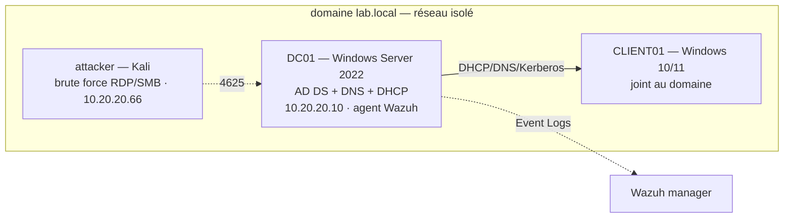

# ad-lab — Active Directory + détection Wazuh

Mini-lab **Active Directory** (Windows Server 2022 sous VirtualBox) : administration du
domaine (AD DS, DNS, DHCP, OU, GPO) et **détection des authentifications en échec**
(brute force) via un SIEM **Wazuh** sur les Windows Event Logs (Event ID 4625).

> **Statut : squelette documenté, preuves à capturer.**
> Les scripts PowerShell d'administration sont fonctionnels et commentés ; les règles
> Wazuh sont des modèles à valider sur logs réels. Chaque capture d'écran / alerte
> manquante est listée dans [`captures/`](captures/) sous forme de `TODO-PREUVE_*.md`.
> **Aucune capture ni log n'est inventé dans ce dépôt.**

## Topologie



Détail et plan d'adressage : [`topology/`](topology/).

## Administration (scripts PowerShell)

| Script | Rôle |
|---|---|
| [`scripts/New-OU.ps1`](scripts/New-OU.ps1) | Crée les OU `Employes`, `IT`, `Serveurs` (idempotent) |
| [`scripts/New-Users.ps1`](scripts/New-Users.ps1) | Crée les comptes depuis `users.sample.csv` (données fictives, mot de passe saisi au lancement) |
| [`scripts/Set-PasswordPolicy.ps1`](scripts/Set-PasswordPolicy.ps1) | Politique de mot de passe + verrouillage de compte |

Le CSV d'exemple ne contient **aucune donnée réelle ni secret**.

## GPO

Trois stratégies documentées (politique de mot de passe, verrouillage, lecteur réseau) —
voir [`gpo/README.md`](gpo/README.md).

| GPO | Portée | Effet |
|---|---|---|
| `Pol-MotDePasse` | Domaine | Longueur 12, complexité, historique 24 |
| `Pol-Verrouillage` | Domaine | Verrouillage après 5 échecs / 15 min |
| `Pol-LecteurReseau` | OU `Employes` | Montage d'un lecteur réseau `P:` |

## Détection

Scénario brute force RDP/SMB → Event ID **4625** → corrélation Wazuh → alerte.
MITRE **T1110**. Détail : [`detection/wazuh/brute_force_rdp_smb.md`](detection/wazuh/brute_force_rdp_smb.md).

| Observation | Event ID | Règle Wazuh | MITRE |
|---|---|---|---|
| Échec d'ouverture de session | 4625 | `100200` | T1110 |
| Répétition même source | 4625 × N | `100201` | T1110 |
| Compte verrouillé | 4740 | `100202` | T1110 |

Règles et collecte : [`detection/wazuh/`](detection/wazuh/). IoC + MITRE : [`docs/IoC.md`](docs/IoC.md).

## Structure du dépôt

```
topology/          schéma + plan d'adressage
scripts/           *.ps1 (OU, users, politique) + users.sample.csv (fictif)
gpo/               description des GPO (export réel à ajouter)
detection/wazuh/   local_rules.xml, ossec.conf.sample, scénario brute force
captures/          captures d'écran / alertes (ou TODO-PREUVE_*.md)
docs/IoC.md        indicateurs + correspondance MITRE ATT&CK
```

## Avertissement

Lab **pédagogique et défensif**. Les tests d'authentification ne doivent viser qu'une
infrastructure dont on est propriétaire, dans un environnement isolé, sur des comptes de test.

## Licence

[MIT](LICENSE) — © 2026 HARCHOUNE Abdellah
