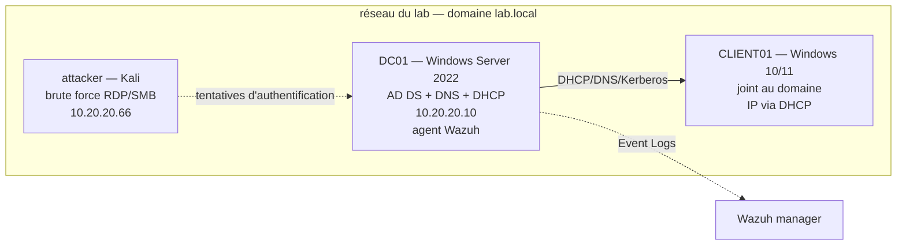

# Topologie du lab Active Directory

## Plan d'adressage (provisoire)

| Machine | VM VirtualBox | Rôle | IP | Statut |
|---|---|---|---|---|
| `DC01` | `DC` | Contrôleur de domaine `lab.local` — AD DS, DNS, DHCP | 10.20.20.10/24 | à confirmer |
| `CLIENT01` | `Windows-LTCS-lab` | Poste joint au domaine | DHCP | à confirmer |
| `attacker` | `Kali-Lab` | Brute force RDP/SMB | 10.20.20.66/24 | à confirmer |
| SIEM | à déployer | Wazuh manager (collecte des Event Logs) | 10.20.20.20/24 | à installer |

> Dans l'inventaire VirtualBox actuel, la VM `DC` et `Windows-LTCS-lab` sont sur le
> NAT-network `10.0.2.0/24`, pas sur un réseau interne dédié. Pour reproduire ce lab
> proprement, les basculer sur un réseau interne isolé et fixer les IP ci-dessus
> (voir `captures/TODO-PREUVE_topologie.md`).

## Domaine

- Forêt / domaine : `lab.local`
- Contrôleur : `DC01.lab.local`
- Unités d'organisation : `Employes`, `IT`, `Serveurs` (voir `scripts/New-OU.ps1`).
